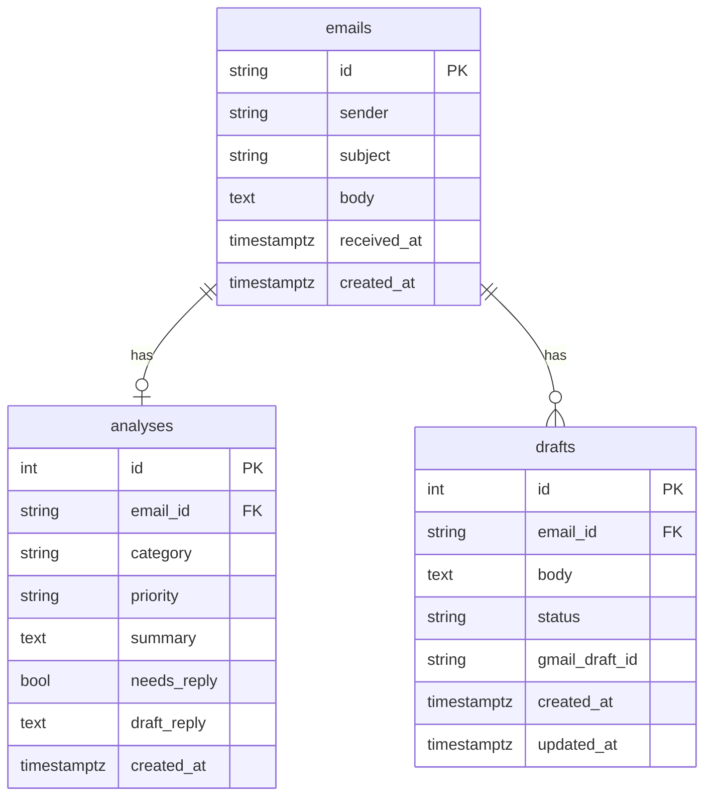

# Architecture

## Flow

```
Gmail / demo data -> Ingest -> Analyzer -> LLM provider
                                  |
                              PostgreSQL <-> API <-> Dashboard <-> reviewer
                                              |
                                        Gmail drafts (never sent)
```

1. A scheduler runs once a day and fetches new mail through a `MailProvider`.
2. The analyzer asks an `LLMProvider` for structured output (category, priority, summary, needs reply, draft) validated with Pydantic.
3. Results are stored in PostgreSQL.
4. The reviewer opens the dashboard, edits a draft and approves or discards it.
5. On approval the API creates the draft in the mailbox. Nothing is ever sent.

## Backend layers

Each layer depends only on the one below it.

| Layer | Folder | Responsibility |
|---|---|---|
| Entry points | `app/scheduler.py`, `app/api/` | Scheduled run and REST API |
| Services | `app/services/` | Ingest, analysis, daily digest, drafts, metrics, demo data |
| Ports and adapters | `app/providers/mail/`, `app/providers/llm/`, `app/db/` | Mail, LLM and persistence behind interfaces |
| Cross-cutting | `app/domain/`, `app/core/` | Pydantic models, enums, settings from environment |

## Data model

PostgreSQL holds three tables. An email has at most one analysis and any number of drafts. Deleting an email deletes its analysis and drafts.



Draft status values are `proposed`, `approved` and `discarded`.

## Persistence

- `app/db/models.py`: SQLAlchemy 2 table classes (`EmailRecord`, `AnalysisRecord`, `DraftRecord`).
- `app/db/session.py`: one shared engine and session factory. `get_session()` yields a session and closes it afterwards.
- `app/db/repositories.py`: `EmailRepository`, `AnalysisRepository` and `DraftRepository`. They take and return domain models (Pydantic), so services never touch tables or SQL. Repositories never commit: the calling service decides when to commit or roll back.
- `app/core/dates.py`: `utc_day()`, the UTC calendar day of a datetime. SQLite returns naive datetimes and PostgreSQL timezone-aware ones, so every service that groups by day goes through it.
- `migrations/`: Alembic migrations. Apply them with `uv run alembic upgrade head`.

## Providers

Mail and LLM access sit behind two small interfaces, so the rest of the app never knows which vendor or mailbox is behind them.

| Interface | Operations | Implementations |
|---|---|---|
| `MailProvider` | `fetch_new()`, `create_draft(email, body)` | `DemoMailProvider` (reads `demo/emails.json`, dates them relative to now, keeps drafts in memory) and `GmailMailProvider` (Gmail API) |
| `LLMProvider` | `analyze_email(email)` returns a validated `EmailAnalysis` | `FakeLLMProvider` (keyword rules, no API key) |

`MailProvider` has no send operation. The LangChain implementation of `LLMProvider` will implement the same interface as the fake one.

`demo/emails.json` holds 36 fictitious emails spread over 7 days (7 urgent, 14 needing a reply, 15 informational), used by demo mode and the tests. Instead of a date, each entry has `days_ago` and `time_utc`. `DemoMailProvider` turns them into real dates every time it fetches, so the demo never looks stale. An email whose time has not come yet today is moved to the day before, so no email comes from the future. Tests pass a fixed `now`.

## Gmail

`GmailMailProvider` (`app/providers/mail/gmail.py`) talks to the Gmail API through a client that is passed in, so tests use a fake one and never touch the network.

- **Reading:** `fetch_new()` returns the messages that match `GMAIL_QUERY` (by default `in:inbox newer_than:2d`), up to `GMAIL_MAX_EMAILS`. The email id is the Gmail message id, so the ingest step skips what it already has. The body is the plain text part, or the text of the HTML when there is none, cut at 20,000 characters. Some newsletters (Odoo's, for one) put their whole stylesheet in the plain text part, so a plain part with three or more CSS rules is replaced by the text of the HTML part, and lines that only list a link (`[3] https://...`) are dropped.
- **Drafts:** `create_draft()` builds a reply and saves it as a Gmail draft in the same thread. It asks Gmail for the thread id and the original `Message-ID` at that moment, so the stored email needs neither. The reply goes to `Reply-To` when present, its subject gets one `Re:` and it carries `In-Reply-To` and `References`. A header with a line break is rejected, so a hostile email cannot add recipients.
- **Scopes:** `gmail.readonly` to read and `gmail.compose` to create drafts. `gmail.compose` is the narrowest scope that can create a draft, and Google also lets it send mail. The promise that nothing is sent therefore rests on the code: `MailProvider` and `GmailMailProvider` have no send operation, and a test checks it.
- **Authorization:** `uv run python -m app.cli authorize-gmail` opens the Google consent page once and prints a refresh token for `.env`. From then on the library asks Google for short-lived access tokens by itself.
- **Token lifetime:** while the Google Cloud app is in Testing, Google expires the refresh token after 7 days. Moving the app to In production (unverified, for one account) avoids that, at the price of an "unverified app" warning on the consent page. Otherwise, run the authorize command again each week.
- **Running by hand:** `uv run python -m app.cli run-pipeline` fetches and analyses the mail now, instead of waiting for the daily run.

## Services

Each service takes the database session and its providers through the constructor, and commits its own transactions.

| Service | Operations | Notes |
|---|---|---|
| `IngestService` | `run()` | Stores the emails the database does not have yet and returns how many were new. |
| `AnalysisService` | `run()` | Analyses every email without an analysis and creates a draft when a reply is needed. Each email has its own transaction: if the model fails on one, that email stays pending and is retried on the next run. |
| `DigestService` | `build()` | Returns a `Digest` of the latest day of mail (`day`): total, counts per category, pending drafts (all days) and that day's emails, each with its draft if it has one, highest priority first and newest first within each priority. |
| `DraftService` | `list_pending()`, `edit()`, `approve()`, `discard()`, `restore()` | `list_pending()` returns the drafts waiting for review of every day, each with its email and analysis, most urgent first. Approving creates the draft in the mailbox first and marks it approved afterwards, so a mailbox failure leaves the database unchanged. A draft that was already approved or discarded cannot be edited, approved or discarded again. A discarded draft can be restored, because nothing reached the mailbox. An approved one cannot: it already exists there. |
| `MetricsService` | `build()` | Returns `Metrics` for the 7 days that end on the day of the newest email: emails per day, emails processed, drafts created, drafts waiting for review and the estimated time saved (2 minutes per email and 6 per draft, both returned in the response). |
| `PipelineService` | `run()` | The daily run: ingest, then analysis. Used by the scheduler and by the demo service. |
| `DemoService` | `run()`, `reset()` | Demo mode only. `run()` runs the pipeline, but first starts over if the mailbox now offers mail from a later day than the stored one, so the dashboard always shows current dates. `reset()` deletes every email, analysis and draft and loads the demo emails again. |

`app/factory.py` is the only place that chooses an implementation for each interface. In demo mode it builds the demo mailbox and the fake model. Outside it, it builds the Gmail mailbox, and the model stays fake (`LLM_PROVIDER=fake`) until the LangChain provider exists, so a real mailbox can be tried first. `build_services(session, mail, llm)` assembles the services on one session.

## API

FastAPI application in `app/main.py`. Routers live in `app/api/` and are mounted under `/api` by `app/api/router.py`. Routers only translate HTTP to service calls: they hold no business logic. Each request gets its own database session (`app/api/dependencies.py`). Interactive documentation is served at `/docs`.

| Endpoint | Purpose |
|---|---|
| `GET /api/digest` | The latest day of mail: totals, counts per category, pending drafts and the day's emails by priority, each with its draft |
| `GET /api/drafts` | Drafts waiting for review, each with its email and analysis, most urgent first |
| `GET /api/metrics` | Emails per day for the last 7 days, drafts created, drafts waiting and estimated time saved |
| `PATCH /api/drafts/{id}` | Edit the text of a pending draft |
| `POST /api/drafts/{id}/approve` | Create the draft in the mailbox and mark it approved |
| `POST /api/drafts/{id}/discard` | Discard a pending draft |
| `POST /api/drafts/{id}/restore` | Undo a discard: the draft waits for review again, with its text. Approved drafts cannot be restored (409) |
| `GET /api/config` | Whether the app runs in demo mode, so the dashboard shows its demo buttons only then |
| `POST /api/demo/run` | Run the pipeline on demand, reloading the demo emails if they are from an earlier day. Demo mode only (403 otherwise) |
| `POST /api/demo/reset` | Delete all data and load the demo emails again. Demo mode only (403 otherwise) |

An unknown draft returns 404 and a draft that was already approved or discarded returns 409. If Gmail access has expired or was revoked, approving returns 503 with a message to authorize again, and if Gmail rejects a request it returns 502. In both cases the draft stays pending, because the mailbox is called before the database changes. The API has no authentication: it is meant for a single reviewer, locally or in a demo.

## Frontend

React single-page app in `frontend/`, built with Vite. It only talks to the REST API under `/api`.

| Piece | Choice | Role |
|---|---|---|
| Build and dev server | Vite | In development it proxies `/api` to the API on port 8000, so requests are same-origin, as in production |
| Language | TypeScript 5.9 | Pinned to 5.x because `openapi-typescript` does not support 7 yet |
| Styling | Tailwind v4 | Utility classes. Design tokens (colors, relief shadows, radii, light and dark themes) live in `src/styles/tokens.css` and are exposed as utilities (`bg-mint`, `shadow-raise-2`, `rounded-card`) |
| Data | TanStack Query | Caching, loading and error states. Every action refreshes all queries |
| Lint | oxlint | `npm run lint` |
| Tests | Vitest, Testing Library, axe-core | `npm test` |

```
src/
  api/         schema.d.ts (generated), client.ts (fetch wrapper, ApiError), hooks.ts (queries and actions)
  views/       Overview, Drafts and Metrics (one view per tab)
  components/  Card, Chip, Tile, Tabs, EmailRow, EmailCard, AiCard, DraftEditor, NoticeProvider, SummaryCard, InboxCard, EmailDetail, DayChart, MixCard, ResetDemoButton, EmptyState, Button, Icon, ThemeToggle
  lib/         theme.ts (light or dark), format.ts (names and dates), categories.ts (labels and tones), notice.ts (message shown after an action)
  styles/      tokens.css
```

The Overview view holds the state (filter, search, selected email) and reads the digest. It shows the summary tiles, which double as filters, the inbox by priority and, beside it, two separate cards for the selected email: the email as it arrived, and the AI analysis with a purple mark so the reader always knows what the model produced. A day with no analysed emails, a loading digest and a failed request each get their own state.

The Drafts view is the human review. It lists every pending draft, of any day, next to the email it answers, with the same AI card and editor as the Overview, and below them the drafts already decided. In both places the reviewer edits the text, approves or discards:

- Edits are saved to the API when the text box loses focus (`PATCH /api/drafts/{id}`), so they survive choosing another email or reloading. Approving saves any unsaved change first.
- A discarded draft shows an Undo discard button, both in the AI card and in the Reviewed list, so a mistaken click is not final. Approved drafts have no undo: they already exist in the mailbox.
- Approving creates the draft in the mailbox and never sends. A short message under the tabs confirms what happened for seven seconds.
- Every action refreshes all the queries, also after a failure. A 404 or 409 (for example a draft decided in another window) shows the API's message and brings the screen up to date.
- A request that cannot reach the API shows "Could not reach the API." after one quick retry.

The Metrics view shows the last seven days: four figures (emails processed, drafts created, estimated time saved, drafts waiting), a bar chart of emails per day drawn with Recharts, and the category mix of the latest day. The view is loaded only when its tab opens, because Recharts is about half of the JavaScript.

Keyboard and screen readers: the tabs follow the WAI-ARIA pattern (only the selected tab is in the tab order, arrow keys, Home and End move between tabs, each tab names the panel it controls), a skip link jumps to the main content, every card that is a landmark has a unique name, the chart and the mix bar have a text description, and the transitions stop when the system asks for reduced motion.

The demo buttons (Reset demo in the header, Load demo emails when there is no data) appear only when `GET /api/config` says the app runs in demo mode. Outside it they would get a 403.

`src/api/schema.d.ts` is generated from the API's OpenAPI description. With the API running, `npm run gen:api` regenerates it, and `tsc` then reports any place where the frontend no longer matches the backend. The generated file is committed, so building does not need the API.

### Frontend tests

The tests run in jsdom with Testing Library. `src/test/fakeApi.ts` is a small stand-in for the backend: it answers the API calls from memory and records the ones that change something, so a test can check what the screen sent and in which order (for example that edited text is saved before a draft is approved). The tests cover the formatting helpers, the three views, the review flow including a 409 conflict, the keyboard navigation of the tabs, demo mode, the theme, and an axe-core accessibility check of each tab. The Recharts bars are not drawn in jsdom, so the chart is checked through its text description.

## Serving the dashboard

In production the API serves the built dashboard (`frontend/dist`) at `/`, so one process and one port serve both (`serve_frontend` in `app/main.py`, built on FastAPI's `app.frontend`). API routes win over the files, and an unknown `/api` path still answers a JSON 404. If `frontend/dist` does not exist, as in development or in the backend tests, only the API runs and the dashboard comes from the Vite server.

## Scheduler

`app/scheduler.py` registers one APScheduler job, `daily-pipeline`, that runs `PipelineService` (ingest, then analysis) every day. The scheduler runs in a background thread of the API process: `app/main.py` starts it on startup and stops it on shutdown. The job opens its own database session because there is no HTTP request.

| Variable | Default | Meaning |
|---|---|---|
| `SCHEDULER_ENABLED` | `true` | Start the scheduler with the API |
| `SCHEDULE_TIME` | `07:00` | Time of the daily run (`HH:MM`) |
| `SCHEDULE_TIMEZONE` | `UTC` | IANA timezone of `SCHEDULE_TIME` |

Jobs are kept in memory, so a run missed while the process was down is not replayed. Run the API with a single worker: with several, the job would run once per worker.

## Design rules

1. `MailProvider` has no send operation, and a test guarantees it.
2. The LLM provider is swappable and implemented with LangChain (`providers/llm/langchain_provider.py`). Vendor and model come from `LLM_PROVIDER` and `LLM_MODEL`. A fake provider is used in tests and demo mode.
3. Dependencies are injected through constructors. A single factory reads the settings and builds the services, so services never know which vendor is behind `LLMProvider`.
4. Email content is untrusted input. The LLM has no tools and its output is validated before it is stored.
5. Configuration comes only from environment variables.
