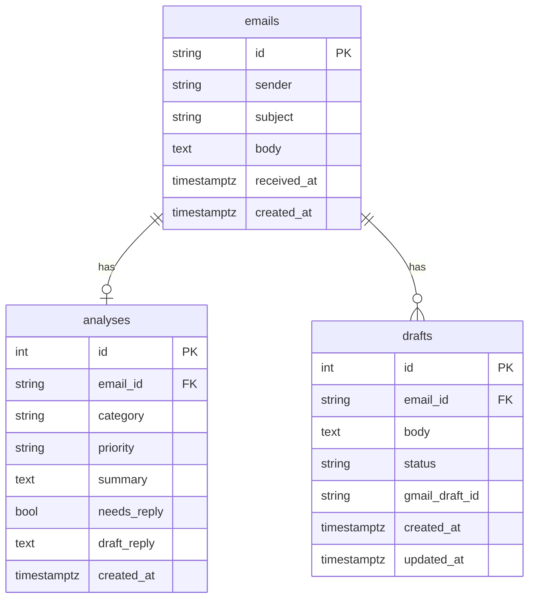

# Architecture

## Flow

```
Gmail / demo data -> Ingest -> Analyzer -> LLM provider
                                  |
                              PostgreSQL <-> API <-> Dashboard <-> reviewer
                                              |
                                        Gmail drafts (never sent)
```

1. A scheduler runs once a day and fetches new mail through a `MailProvider`.
2. The analyzer asks an `LLMProvider` for structured output (category, priority, summary, needs reply, draft) validated with Pydantic.
3. Results are stored in PostgreSQL.
4. The reviewer opens the dashboard, edits a draft and approves or discards it.
5. On approval the API creates the draft in the mailbox. Nothing is ever sent.

## Backend layers

Each layer depends only on the one below it.

| Layer | Folder | Responsibility |
|---|---|---|
| Entry points | `app/scheduler.py`, `app/api/` | Scheduled run and REST API |
| Services | `app/services/` | Ingest, analysis, daily digest, drafts |
| Ports and adapters | `app/providers/mail/`, `app/providers/llm/`, `app/db/` | Mail, LLM and persistence behind interfaces |
| Cross-cutting | `app/domain/`, `app/core/` | Pydantic models, enums, settings from environment |

## Data model

PostgreSQL holds three tables. An email has at most one analysis and any number of drafts. Deleting an email deletes its analysis and drafts.



Draft status values are `proposed`, `approved` and `discarded`.

## Persistence

- `app/db/models.py`: SQLAlchemy 2 table classes (`EmailRecord`, `AnalysisRecord`, `DraftRecord`).
- `app/db/session.py`: one shared engine and session factory. `get_session()` yields a session and closes it afterwards.
- `app/db/repositories.py`: `EmailRepository`, `AnalysisRepository` and `DraftRepository`. They take and return domain models (Pydantic), so services never touch tables or SQL. Repositories never commit: the calling service decides when to commit or roll back.
- `migrations/`: Alembic migrations. Apply them with `uv run alembic upgrade head`.

## Providers

Mail and LLM access sit behind two small interfaces, so the rest of the app never knows which vendor or mailbox is behind them.

| Interface | Operations | Implementations |
|---|---|---|
| `MailProvider` | `fetch_new()`, `create_draft(email, body)` | `DemoMailProvider` (reads `demo/emails.json`, keeps drafts in memory) |
| `LLMProvider` | `analyze_email(email)` returns a validated `EmailAnalysis` | `FakeLLMProvider` (keyword rules, no API key) |

`MailProvider` has no send operation. The Gmail and LangChain implementations will implement the same interfaces.

`demo/emails.json` holds 11 fictitious emails (3 urgent, 4 needing a reply, 4 informational) used by demo mode and the tests.

## Services

Each service takes the database session and its providers through the constructor, and commits its own transactions.

| Service | Operations | Notes |
|---|---|---|
| `IngestService` | `run()` | Stores the emails the database does not have yet and returns how many were new. |
| `AnalysisService` | `run()` | Analyses every email without an analysis and creates a draft when a reply is needed. Each email has its own transaction: if the model fails on one, that email stays pending and is retried on the next run. |
| `DigestService` | `build()` | Returns a `Digest`: total, counts per category, pending drafts and all analysed emails, highest priority first and newest first within each priority. |
| `DraftService` | `list_pending()`, `edit()`, `approve()`, `discard()` | Approving creates the draft in the mailbox first and marks it approved afterwards, so a mailbox failure leaves the database unchanged. A draft that was already approved or discarded cannot change again. |
| `PipelineService` | `run()` | The daily run: ingest, then analysis. Used by the scheduler and by the demo endpoint. |

`app/factory.py` is the only place that chooses an implementation for each interface. In demo mode it builds the demo mailbox and the fake model. `build_services(session, mail, llm)` assembles the services on one session.

## API

FastAPI application in `app/main.py`. Routers live in `app/api/` and are mounted under `/api` by `app/api/router.py`. Routers only translate HTTP to service calls: they hold no business logic. Each request gets its own database session (`app/api/dependencies.py`). Interactive documentation is served at `/docs`.

| Endpoint | Purpose |
|---|---|
| `GET /api/digest` | Totals, counts per category, pending drafts and every analysed email by priority |
| `GET /api/drafts` | Drafts waiting for review |
| `PATCH /api/drafts/{id}` | Edit the text of a pending draft |
| `POST /api/drafts/{id}/approve` | Create the draft in the mailbox and mark it approved |
| `POST /api/drafts/{id}/discard` | Discard a pending draft |
| `POST /api/demo/run` | Run the pipeline on demand. Demo mode only (403 otherwise) |

An unknown draft returns 404 and a draft that was already approved or discarded returns 409. The API has no authentication: it is meant for a single reviewer, locally or in a demo.

## Design rules

1. `MailProvider` has no send operation, and a test guarantees it.
2. The LLM provider is swappable and implemented with LangChain (`providers/llm/langchain_provider.py`). Vendor and model come from `LLM_PROVIDER` and `LLM_MODEL`. A fake provider is used in tests and demo mode.
3. Dependencies are injected through constructors. A single factory reads the settings and builds the services, so services never know which vendor is behind `LLMProvider`.
4. Email content is untrusted input. The LLM has no tools and its output is validated before it is stored.
5. Configuration comes only from environment variables.
